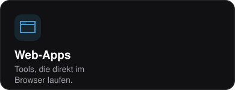
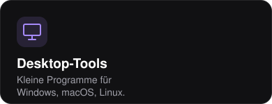
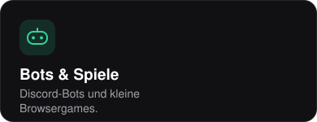

# Hi, ich bin LYNEX

Gründer von **[CodevoStudio](https://codevostudio.de)**, einem unabhängigen Software-Studio aus Deutschland. 
Ich baue eigene Web-Apps, Desktop-Tools, Discord-Bots und Spiele, die meisten davon kostenlos nutzbar.

 

  

 

 

### Was ich baue

  
  
  

 

### Projekte

  
  
  
  

 

### Technik

  

 

### Gerade

- Arbeite an **CS | Helper** und **Toolbox**
- Feedback, Ideen oder einen Fehler gefunden? Am schnellsten im **[Discord](https://discord.gg/DftTSga3sh)** oder über **[codevostudio.de/kontakt](https://codevostudio.de/kontakt)**

 

<picture>
  
</picture>
