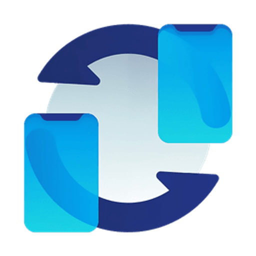
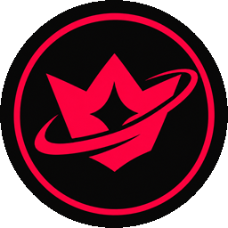
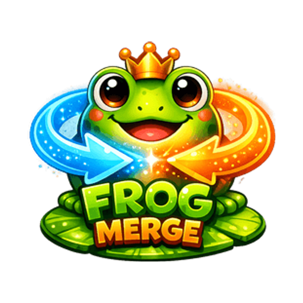

### Hey, I'm LYNEX 👋

Founder of **[CodevoStudio](https://codevostudio.de)**, an independent software studio from Germany. 
I build my own web apps, desktop tools, Discord bots and games, most of them free to use.

 

 

## 🚀 Projects

<table>
  <tr>
    <td width="64" align="center"></td>
    <td><b><a href="https://codevostudio.de/projects/localdrop">LocalDrop</a></b> &nbsp; Send files between your devices. No cloud, no account, just drag and drop.</td>
  </tr>
  <tr>
    <td width="64" align="center"></td>
    <td><b><a href="https://codevostudio.de/projekte">CS | Helper</a></b> &nbsp; Public moderation and utility bot for Discord servers.</td>
  </tr>
  <tr>
    <td width="64" align="center"></td>
    <td><b><a href="https://codevostudio.de/projects/toolbox">Toolbox</a></b> &nbsp; Handy little tools for everyday tasks, right in your browser.</td>
  </tr>
  <tr>
    <td width="64" align="center"></td>
    <td><b><a href="https://codevostudio.de/projects/frog-merge">Frog Merge</a></b> &nbsp; Merge browser game with 50+ unique frogs to unlock.</td>
  </tr>
</table>

## 🛠️ Tech stack

  
  
  
  
  
  
  

## ⚡ Right now

- 🔨 Working on **CS | Helper** and **Toolbox**
- 💬 Feedback, ideas or a bug? Fastest on **[Discord](https://discord.gg/DftTSga3sh)** or via **[codevostudio.de/kontakt](https://codevostudio.de/kontakt)**
- 🇩🇪 Lieber auf Deutsch? Alles dazu auf **[codevostudio.de](https://codevostudio.de)**
